<div align="center">


<br/>


</div>

<br/>


<table>
<tr>
<td width="46%" valign="top">


</td>
<td valign="top">

### `> whoami`

I'm **Aya**. I study **networks, systems and cybersecurity**, and I'm happiest when I'm making things hard to break: segmenting networks, hardening hosts and reading the logs afterwards to see who knocked.

```bash
$ cat /etc/aya.conf
name        = "Aya"
handle      = "A-straya"
studying    = ["networks", "systems", "cybersecurity"]
specialty   = "securing systems & networks"
currently   = ["home lab", "VLANs + firewall rules", "hardening checklists"]
mindset     = "trust nothing. verify everything."
hat_color   = "▒▒▒▒▒▒"        # classified
$ _
```

> white hat by day, ▒▒▒▒▒ by night.

</td>
</tr>
</table>

<br/>


<div align="center">

** Network & Defense**


**  Systems & Code**


</div>

<br/>


<p align="center"><sub>how I think about a network: untrusted outside, default-deny at the edge, segmented inside, everything logged.</sub></p>


<br/>



<br/>


| | Quest | Status |
|:-:|---|:-:|
|  | Build a segmented home lab (firewall + VLANs + a few VMs) | `COMPLETE` |
|  | Write a hardening checklist for Linux & Windows hosts | `IN PROGRESS` |
|  | Study for CCNA / Security+ | `IN PROGRESS` |
|  | Set up IDS + central logging and tune the alerts | `QUEUED` |
|  | Land a network / security internship | `FINAL BOSS` |
| ▒▒ | ▒▒▒▒▒▒▒▒▒▒▒▒▒▒▒▒▒▒ | `[REDACTED]` |

> Edit these to match what's real. Honest beats impressive.

<br/>


<div align="center">


<br/><br/>

<!-- Snake: run Actions > Generate Snake once after uploading -->


</div>

<br/>


| Project | What it does | Stack |
|---|---|---|
|  **segmented-home-lab** | Firewall, VLANs and ACLs documented step by step | pfSense, VirtualBox |
|  **hardening-checklists** | Baseline hardening for Linux & Windows hosts | Markdown, Bash |
|  **packet-notes** | Wireshark captures explained: normal vs suspicious | Wireshark, tshark |
|  **vpn-lab** | WireGuard tunnels between lab sites | WireGuard, Linux |

> Rename these to your real repos and pin your best 4–6.

<br/>


<p align="center">
  <a href="https://linkedin.com/in/YOUR_LINKEDIN"></a>
  <a href="mailto:YOUR_EMAIL"></a>
  <a href="https://discord.com/users/YOUR_DISCORD_ID"></a>
  <a href="https://tryhackme.com/p/YOUR_THM_USERNAME"></a>
</p>

<details>
<summary><b> CLASSIFIED: clearance required</b></summary>
<br/>

```
aGF0X2NvbG9yPSM4MDgwODAgLy8gc2ho
```

<sub>not encrypted, just wearing a hat. which color? </sub>

</details>

<br/>

<div align="center">

<sub>`> trust nothing. verify everything._`</sub>

<br/><br/>


</div>


